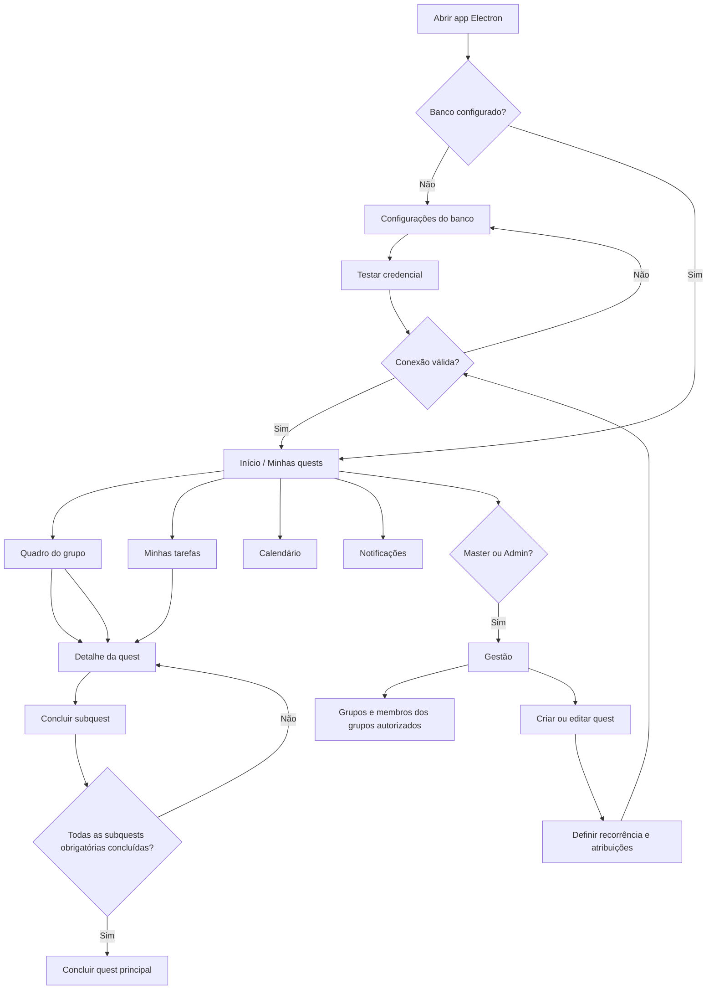
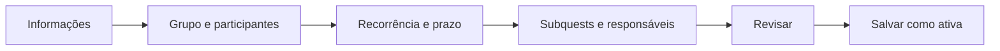

# Fluxo do produto — sistema de quests

> Fluxo de produto para orientar o novo app. A referência visual e técnica é `C:\Sites\Funil versão 2`.

## Objetivo

Organizar tarefas recorrentes como quests. Uma quest pode ser compartilhada por um grupo, ter responsáveis individuais por subquests e só ser concluída automaticamente quando todas as subquests obrigatórias estiverem concluídas.

## Base visual e técnica

- **Shell da aplicação:** seguir o padrão desktop Electron + React + TypeScript. O programa roda instalado/localmente; não hospeda um servidor web. Barra de título própria e menu lateral recolhível; manter páginas em área principal com rolagem independente.
- **Navegação:** adaptar o menu da referência para Dashboard, Minhas quests, Grupos, Calendário, Relatórios e Configurações. Exibir Gestão de usuários e grupos conforme o papel. Admins podem administrar vários grupos atribuídos.
- **Páginas:** usar dashboard com cards de resumo e listas/quadros para trabalho; filtros e busca ficam no cabeçalho da lista. Criar/editar quest em modal por etapas, seguindo o padrão dos formulários existentes. Detalhe da quest pode ser página ou modal amplo.
- **Estilo:** reutilizar tokens CSS (`--bg-primary`, `--bg-secondary`, `--text-primary`, `--text-secondary`, `--border-color`, `--accent-color`), suporte claro/escuro e temas prontos. Usar espaçamento, bordas, cartões e ícones Lucide do app de referência.
- **Estado da interface:** manter Zustand para estado compartilhado e chamadas da UI pela API isolada do preload, sem acesso direto a Node ou banco no renderer.
- **Persistência:** seguir a abstração `DatabaseAdapter`/`KnexDatabaseAdapter` e a `DatabaseFactory` da referência. SQLite local é o padrão; provedores PostgreSQL, Supabase, MySQL/MariaDB e Turso também estão disponíveis. As novas entidades devem integrar todos os adaptadores suportados ou documentar explicitamente qualquer limitação.
- **Segurança Electron:** operações de dados passam por IPC com validação no processo principal, preservando isolamento de contexto, sandbox e Node desativado no renderer.

**Arquitetura escolhida:** o app é desktop Electron e se conecta diretamente ao banco escolhido pelo usuário; não há hospedagem de um servidor do app. A conexão é configurada em cada instalação e os segredos ficam criptografados com o armazenamento seguro do sistema operacional. O app suporta SQLite local, PostgreSQL, Supabase/PostgreSQL, MySQL/MariaDB e Turso/libSQL. Usuários do mesmo workspace compartilham dados conectando-se ao mesmo banco.

O segredo de conexão autentica a instalação no banco, mas não identifica automaticamente a pessoa usando o app. Perfis e papéis Master/Admin/Membro continuam como regras de produto; para impor esses papéis de forma segura entre instalações, o banco precisa oferecer credenciais/políticas individuais ou o app precisa de uma chave de usuário por pessoa validada em armazenamento compartilhado. A credencial de banco nunca é exposta ao renderer. Nesta versão, os papéis e membros ainda são demonstração e não constituem controle de acesso individual.

## Papéis e acesso

| Papel | Escopo e ações |
| --- | --- |
| Master (dono do app) | Acesso total; configura o app, cria grupos, convida usuários, define administradores e consulta todas as quests. |
| Admin (responsável por grupos) | Gerencia membros e quests de todos os grupos sob sua responsabilidade; pode atribuir responsáveis e acompanhar progresso. |
| Membro | Consulta quests dos grupos dos quais participa, executa as tarefas atribuídas e atualiza as próprias subquests. |

O acesso ao banco é validado pela credencial configurada. O controle fino por ação e por grupo requer identidade de usuário reconhecida pelo banco e permanece pendente; esconder uma opção na interface não substitui a validação de permissão.

## Mapa de navegação



## Fluxo principal

1. **Abrir o app:** conectar usando o banco configurado neste computador. Se ainda não houver configuração válida, abrir Configurações para selecionar o provedor, informar a credencial e testar a conexão. Quando conectar, abrir “Minhas quests”.
2. **Encontrar trabalho:** início com tarefas vencidas, de hoje, próximas e concluídas recentemente. Filtros por grupo, período, responsável e estado. Alternar entre lista, quadro e calendário.
3. **Abrir uma quest:** mostrar descrição, grupo, responsáveis, prazo, recorrência, histórico e lista de subquests. Membro vê ações permitidas para si; Admin vê controles do grupo.
4. **Executar subquest:** todos os responsáveis atribuídos veem a mesma subquest compartilhada. Qualquer um deles pode concluí-la uma única vez; registrar quem concluiu e quando. A quest principal recalcula o progresso imediatamente. Se o produto precisar que cada pessoa confirme individualmente, isso será uma opção futura de política de conclusão.
5. **Concluir a quest principal:** quando todas as subquests obrigatórias da ocorrência atual forem concluídas, marcar a ocorrência como concluída e registrar data e autor da última alteração. Sem subquests, um responsável autorizado conclui a quest diretamente.
6. **Próxima recorrência:** após concluir a ocorrência atual, criar automaticamente a próxima ocorrência da definição recorrente, preservando histórico e atribuições configuradas. A próxima data deve seguir o intervalo e a regra escolhidos na criação (diária, semanal nos dias da semana selecionados ou mensal); uma quest única não gera outra ocorrência. Não reabrir nem sobrescrever a ocorrência anterior.

## Criar ou editar quest (Master/Admin)



Campos recomendados:

- **Informações:** título, descrição, prioridade e categoria opcional.
- **Grupo e participantes:** grupo responsável e um ou mais participantes. A participação no grupo não implica atribuição individual a todas as subquests.
- **Recorrência:** única, diária, semanal ou mensal; data inicial, término opcional, horário/fuso e regra de vencimento. Guardar a regra na definição para calcular a próxima data quando a ocorrência for concluída.
- **Subquests:** título, descrição, um ou mais responsáveis individuais, prazo opcional e indicação de obrigatoriedade. Começar com todas obrigatórias no MVP para manter a regra de conclusão previsível.
- **Revisão:** resumo das atribuições e da agenda antes de ativar.

## Regras de produto

- Separar a **definição da quest** (o modelo recorrente) de cada **ocorrência** (a execução de uma data/período). Cada ocorrência e subquest mantêm seu próprio estado e histórico.
- Gerar a ocorrência seguinte de forma transacional e idempotente após a conclusão da ocorrência atual. Não gerar recorrência para quests únicas nem depois de atingir a data de término da definição.
- Definir a próxima data com base na regra salva (diária, semanal ou mensal), preservando o dia/horário local selecionado. Se a execução atrasar, calcular a próxima data futura sem criar várias ocorrências atrasadas em cascata.
- Estados sugeridos para ocorrência: `agendada`, `aberta`, `em andamento`, `concluída`, `cancelada`. Atraso é calculado pelo prazo, não precisa ser um estado persistido.
- Progresso: subquests obrigatórias concluídas ÷ total de subquests obrigatórias. Se o total for zero, conclusão é manual.
- Cancelar uma ocorrência não cancela automaticamente a definição recorrente nem as outras ocorrências.
- Alterar uma definição recorrente afeta novas ocorrências. Ocorrências existentes mantêm um retrato dos dados usados na sua criação, salvo edição explícita daquela ocorrência.
- Evitar gerar duas ocorrências para a mesma definição e período, mesmo em caso de repetição de execução do agendador.
- Ao remover um membro, preservar o histórico. Reatribuir tarefas abertas antes de retirar o acesso do grupo.

## Organização lógica dos dados

Reutilizar o padrão relacional da referência: tabelas com IDs, chaves estrangeiras, índices e migrações no adaptador compartilhado. A estrutura conceitual proposta é:

```text
User ──< GroupMembership >── Group
User ──< Role / escopo
Group ──< AdminGroupScope >── User (admins podem pertencer a vários grupos)
Group ──< QuestDefinition
QuestDefinition ──< QuestOccurrence ──< SubquestOccurrence
User ──< Assignment >── QuestOccurrence ou SubquestOccurrence (muitos para muitos)
QuestOccurrence ──< ActivityLog
```

Entidades e responsabilidades:

- **User:** identidade, credenciais gerenciadas pelo provedor de autenticação e estado da conta.
- **Group:** unidade de organização e autorização.
- **GroupMembership:** vínculo de usuário a grupo e papel naquele escopo (`admin` ou `member`). O papel `master` é global à aplicação.
- **QuestDefinition:** título, descrição, grupo, regra de recorrência, configuração padrão das subquests e criador.
- **QuestOccurrence:** instância agendada com datas, estado e retrato dos campos relevantes da definição.
- **SubquestOccurrence:** tarefa executável vinculada à ocorrência, com estado próprio e responsáveis associados por `Assignment`.
- **Assignment:** associação explícita para permitir múltiplos responsáveis sem duplicar a tarefa; o estado de conclusão pertence à subquest compartilhada, com usuário/data de conclusão registrados.
- **ActivityLog:** auditoria de criação, edição, atribuição, conclusão e cancelamento.

IDs, datas e tipos devem ser compatíveis com todos os adaptadores que o app oferece. Armazenar instantes normalizados e guardar o fuso da recorrência; adicionar índices por grupo/estado/prazo e restrição única por definição/período. O schema deve ser criado/migrado pela camada de inicialização de banco, sem SQL específico no renderer. Como os adaptadores oferecem bancos locais e remotos, validar o comportamento transacional da criação da ocorrência e subquests em cada provedor.

## Telas do MVP

1. Login e recuperação de acesso.
2. Início com resumo e lista de quests.
3. Detalhe da quest com progresso e subquests.
4. Formulário de criação/edição em etapas.
5. Gestão de grupos, membros e convites (Master/Admin conforme escopo).
6. Calendário e filtros básicos.

## Análise do fluxo por tópico

### 1. Acesso ao workspace

O usuário abre o app instalado, configura a credencial do banco uma vez por computador e testa a conexão. Todas as instalações autorizadas apontam para o mesmo banco externo. O Master tem escopo global; Admins podem ter vínculo administrativo com vários grupos; membros veem os grupos em que participam. O acesso individual precisa ser acrescentado se a equipe precisar de auditoria por pessoa e restrições por papel.

**Resultado esperado:** banco compartilhado conectado e credencial guardada localmente com proteção do sistema operacional. A credencial do banco identifica o app/instalação; ainda não substitui login ou chave individual.

### 2. Dashboard e foco diário

O início prioriza tarefas de hoje e atrasadas, exibe progresso das quests compartilhadas e resume atividade recente. A pessoa abre o detalhe para entender objetivo, prazo, grupo e quem está colaborando. Busca e filtros reduzem a lista sem alterar atribuições ou permissões.

**Resultado esperado:** o membro entende o que precisa fazer agora; o Admin compara o andamento dos grupos que administra; o Master acompanha o workspace inteiro.

### 3. Grupos e pessoas

O Master cria grupos, convida pessoas e atribui um ou mais Admins. Um Admin pode administrar vários grupos, cada vínculo com seu próprio escopo. A remoção de vínculo tira acesso futuro, mas preserva autoria, atribuições e histórico. Reatribuições devem ser explícitas.

**Resultado esperado:** nenhuma quest de um grupo aparece para usuário sem vínculo; mudanças de papel ficam registradas no histórico.

### 4. Definição e agendamento de quests

Master/Admin escolhe grupo, participantes, descrição, prazo inicial e frequência (`Única`, `Diária`, `Semanal`, `Mensal`). Na frequência semanal, também seleciona um ou mais dias; a primeira ocorrência mantém o prazo informado e as seguintes usam o próximo dia selecionado. A recorrência fica na definição da quest. Cada execução ganha uma ocorrência independente, com prazo, responsáveis e estado próprios. Ao concluir a ocorrência, o sistema cria a seguinte segundo a regra persistida; a quest única encerra sem nova ocorrência.

**Resultado esperado:** uma falha de conexão ou repetição do evento de conclusão não cria duas ocorrências para o mesmo período. Edições da definição valem para ocorrências futuras; histórico concluído permanece imutável, exceto por correção explícita e auditada.

### 5. Subquests e colaboração

Uma quest pode ter zero ou várias subquests. Cada subquest admite mais de um responsável, mas representa uma entrega compartilhada: qualquer responsável autorizado conclui uma vez. Com todas as subquests obrigatórias concluídas, a ocorrência principal conclui automaticamente. Se não houver subquests, um responsável autorizado conclui a própria quest.

**Resultado esperado:** progresso é calculado pela quantidade de subquests obrigatórias concluídas; autoria e horário de conclusão são salvos. A regra inicial não exige que todos os responsáveis confirmem individualmente.

### 6. Recorrência, histórico e auditoria

Ao concluir uma ocorrência recorrente, criar a próxima com subquests abertas e atribuições herdadas da definição. Manter a âncora e o intervalo escolhidos, avançando períodos vencidos até a próxima data futura, sem gerar uma sequência de tarefas atrasadas em cascata. Data final atingida ou ocorrência cancelada interrompe novas gerações conforme a regra da definição.

**Resultado esperado:** nenhuma conclusão sobrescreve uma ocorrência anterior; atividade registra criador, mudanças de responsáveis, conclusões, cancelamentos e horário.

### 7. Dados e segurança

O renderer envia comandos pela API do preload e IPC validado; a camada de domínio aplica regras e a camada de banco mantém as relações e transações. Cada computador armazena seu segredo com `safeStorage`. Para distinguir usuários e aplicar escopo por grupo, definir chaves individuais no banco ou política de acesso por usuário antes de uso com dados restritos.

**Resultado esperado:** cliente não recebe segredo privilegiado compartilhado; transições e geração recorrente são atômicas; conexões e tokens são armazenados com proteção adequada.

## Estado da criação

O app Electron já permite configurar e testar os provedores de banco, persistir quests/ocorrências/subquests e gerar recorrências dentro das transações disponíveis. Calendário mensal, filtros por grupo/prazo, ordenação, relatórios por grupo e gerenciamento de grupos também estão ligados aos dados. Grupos, membros e vínculo de administrador são persistidos no banco.

O primeiro acesso cria um perfil Master local (nome, nickname e e-mail); esse perfil pode ser editado nas Configurações. A janela Electron inicia maximizada e usa uma barra de título integrada com controles próprios. Aparência oferece tema claro/escuro e cores de destaque, armazenados na instalação.

**Limite de segurança:** o perfil Master é local a esta instalação, não é um login e não sincroniza identidade entre computadores. As pessoas adicionais disponíveis continuam sendo identidades de demonstração (`bruno`, `carol`, `diego`, `luiza`). O comando Convidar prepara uma mensagem no cliente de e-mail para um grupo ou quest, mas não registra acesso, não cria conta e não envia credenciais. Os papéis Master/Admin e os vínculos de grupo ainda não autenticam uma pessoa nem impõem autorização no banco; não use a seleção visual como controle de acesso. Login/recuperação, convites ativáveis, credenciais individuais, trilha de auditoria de mudanças de grupo e autorização por pessoa/grupo continuam pendentes. A remoção de pessoas do grupo preserva as atribuições existentes, então reatribua tarefas abertas antes de retirar o vínculo.

As ocorrências mensais mantêm o dia âncora da primeira data, ajustando meses curtos sem deslocar a agenda. A geração continua avançando a partir do prazo planejado até a próxima data futura, sem criar uma cascata de atrasos.

## Decisões pendentes antes de implementar

- A equipe quer uma chave individual por pessoa além da credencial do banco? Essa chave permitiria atribuição e autoria por membro, mas precisa ser armazenada/validada no banco para valer entre computadores.
- Qual provedor será usado em produção? Todos os adaptadores estão disponíveis, mas a conexão real requer host/URL, usuário e credencial fornecidos pelo administrador do banco.
